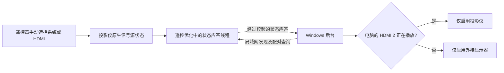

# 按实际信号源切换电脑屏幕

## 按当前信号源选屏

电脑连接三块屏幕：笔记本内屏、G27P6M 显示器、Dangbei 投影仪。真正想要的是：

| 投影仪正在用什么 | 电脑输出到哪里 |
|---|---|
| 系统桌面 / Android 应用 | 只有 G27P6M |
| 电脑接入的 HDMI 2 且 HDMI 正在播放 | 只有投影仪 |
| HDMI 1、其他输入或状态不明 | 优先使用 G27P6M |

笔记本内屏正常情况下不启用。

第一次只用 Windows `SetDisplayConfig` 保存“只有投影仪”的布局，关开测试一度正常。但后来出现投影仪仍在系统、Windows 却把显示器和投影仪设为复制的情况。问题在于：**HDMI 设备在线，不等于它选中了电脑输入**。只记设备连接组合不够。

## 最终结构



投影仪端复用“遥控优化”的前台服务。状态应答只读取原生 HDMI 播放标记和当前源。使用投影遥控器选 HDMI 2，按 Home 返回系统。

本机用到的只读接口为：

```text
vendor.xgimi.hdmi.playing.state
xgimi.hardware.gmpf.IGmTvManager/default 的事务 4
```

历史校准读到系统为 `playing=0, source=0`，电脑原接 HDMI 1 为 `playing=1, source=1`。本机 SDK 将 HDMI 2 对应到源编号 2。2026-11-24 改接后，Windows 配置改为 `computerSource=2`，计划任务已重载。换设备时应按自己的接口读回校准。

改接当时用户反馈外接显示器一插线就黑，当时局域网读到系统源。随后保持 HDMI 插着，重新将外接显示器保存为 Windows 安全基线，用户确认画面恢复。黑屏的具体触发原因尚未定位。

本轮往返读回 `playing=1, source=2` 时切至投影仪单屏，返回 `playing=0, source=0` 时恢复外接显示器单屏。三块屏幕仍为可用接线状态，只有 G27P6M 活动。用户确认了两次画面切换，同时反馈返回外接显示器后刷新率降为 60 Hz。

## 保留外接显示器的刷新率

此前切到未启用的屏幕时，程序交由 Windows 选择分辨率和刷新率。修复后按完整设备路径保存可信单屏模式，同时记录 source 和 target 两端模式。切回时用当前的适配器标识与路径编号重绑，先严格验证，再临时应用。没有记录或驱动不接受该模式时，由 Windows 选择可用模式，已有记录继续保留。

本机记录了 G27P6M 的 2560×1440、279.961 Hz 模式，与历史单屏测量一致。新版后台部署后，用户切入 HDMI 2 再按 Home，确认往返正常；Windows 读回外接显示器恢复 2560×1440、约 280 Hz。[脱敏回读数据](../data/hdmi2-validation.json)。离线回归覆盖完整模式、路径重绑、应用旗标、无效模式、缓存重载和状态判定。[测试方法](../BUILDING.md#windows-屏幕联动)

程序将首个可信模式写入同目录的私有文件 `display-mode-profiles.json`，其中含完整设备路径。已有记录继续保留，本次进程自动回退时选出的模式不进入可信缓存。首次记录时先在 Windows 设好单屏和刷新率，再启动或重启后台。变更刷新率偏好时，先备份并按[构建说明](../BUILDING.md#windows-屏幕联动)重建缓存。

## 没有固定 IP，也不持续使用 ADB

- 电脑向当前物理网卡所在的私有 IPv4 子网发发现查询。
- 只有持有配对密钥的投影仪会应答，随后查询实际返回的地址。
- 每次查询使用新 nonce 与 HMAC-SHA256，检查配对标识和应答校验；拒绝未配对或旧应答。
- 地址不可达时重新发现。配置不写死电脑或投影仪 IP，也不扫描整段 ADB 地址。
- 本次安装完成后主动断开 ADB，之后的往返测试仍正常。

电脑在每轮状态查询后等待约两秒。启动前十秒保留显示器，随后连续三次同时满足 `playing=1` 且 `source=computerSource` 才切投影仪。状态未知、超时或条件失配时优先回显示器，显示器不可用时尝试笔记本内屏。切换可能短暂闪黑。双方需要处于广播可达、彼此互通的局域网。

Windows 设备按 EDID 路径标识匹配，避免依赖会变化的“屏幕 2/3”编号。示例中的 SKG27A9、DBE0030、BOE0AC1 只是这组设备的型号标识，换设备要重配。

## 黑屏后的修正与实机验证

曾在投影仪重启后出现电脑显示器黑屏，拔 HDMI 恢复。事后联动程序未运行，旧状态和日志也没有覆盖黑屏发生时段，因此无法确定具体是哪次切屏或 Windows 布局变化造成的。排查确认旧程序会把缓存的电脑源编号单独判为投影仪输出，即使 `playing` 为 0 或未知。已补上联合判定。

自动切屏现用临时布局。显式执行 `--monitor-only` 才将安全基线保存到 Windows 显示数据库。修正后，电脑三屏保持接线，用户确认原 HDMI 1 和系统往返正常，后台分别读到投影仪单屏和显示器单屏。主动断开 ADB 后已做过原端口往返。没有刻意改变 DHCP 地址做一次真实换 IP 验证。

## 运行和关闭

电脑程序及私有配置安装到 `C:\ProgramData\CodexProjectorDisplayRouter`。旧 HKCU Run 项已移除，改由当前用户交互会话下的计划任务 `CodexProjectorDisplayRouter` 管理。任务登录后延迟十秒启动，失败每分钟重试、最多三次，另有每五分钟的补启动触发。已结束进程并观察计划任务重新启动它。配置迁移后还未专门重新登录 Windows 验证登录触发。投影仪端仍由开机接收器和前台服务启动。

“遥控优化”可独立暂停屏幕联动，电脑收到配对后的暂停状态时保留当前布局。电脑端停用计划任务、停止进程，并恢复显示器的步骤见[恢复方法](07-recovery.md)。[计划任务安装脚本](../tools/Install-Scheduled-Router.ps1) · [计划任务停用脚本](../tools/Disable-Display-Router.ps1)

真实配对文件不在仓库中。示例见 [examples/router-settings.example.json](../examples/router-settings.example.json)，源码构建见 [BUILDING.md](../BUILDING.md)。

参考：[Windows SetDisplayConfig](https://learn.microsoft.com/en-us/windows/win32/api/winuser/nf-winuser-setdisplayconfig)、[Windows 广播后的单播应答](https://learn.microsoft.com/en-us/windows/win32/api/netfw/nf-netfw-inetfwpolicy2-put_unicastresponsestomulticastbroadcastdisabled)。
