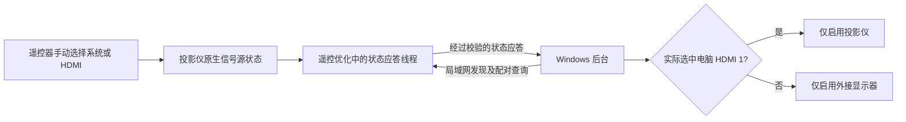

# 按实际信号源切换电脑屏幕

## 需求不是“接上投影仪就只亮投影仪”

电脑连接三块屏幕：笔记本内屏、G27P6M 显示器、Dangbei 投影仪。真正想要的是：

| 投影仪正在用什么 | 电脑输出到哪里 |
|---|---|
| 系统桌面 / Android 应用 | 只有 G27P6M |
| 电脑接入的 HDMI 1 | 只有投影仪 |
| HDMI 2 等其他输入 | 电脑仍用 G27P6M |

笔记本内屏正常情况下不启用。

第一次只用 Windows `SetDisplayConfig` 保存“只有投影仪”的布局，关开测试一度正常。但后来出现投影仪仍在系统、Windows 却把显示器和投影仪设为复制的情况。问题在于：**HDMI 设备在线，不等于它选中了电脑输入**。只记设备连接组合不够。

## 最终结构



投影仪端复用“遥控优化”2.3 的前台服务，不另起一个 Android 常驻进程。只读取原生 HDMI 播放标记和当前源，不自动切投影仪信号源，也不远程执行控制命令。

本机用到的只读接口为：

```text
vendor.xgimi.hdmi.playing.state
xgimi.hardware.gmpf.IGmTvManager/default 的事务 4
```

实机校准：系统为 `playing=0, source=0`，电脑 HDMI 1 为 `playing=1, source=1`。数字必须实机确认，不应猜另一台机器也相同。

## 没有固定 IP，也不持续使用 ADB

- 电脑向当前物理网卡所在的私有 IPv4 子网发发现查询。
- 只有持有配对密钥的投影仪会应答，随后查询实际返回的地址。
- 每次查询使用新 nonce 与 HMAC-SHA256，检查配对标识和应答校验；拒绝未配对或旧应答。
- 地址不可达时重新发现。配置不写死电脑或投影仪 IP，也不扫描整段 ADB 地址。
- 本次安装完成后主动断开 ADB，之后的往返测试仍正常。

电脑约每两秒检查，连续稳定采样后切换；有几秒延迟和短暂闪黑。网络超时约 15 秒后优先回电脑显示器，显示器不在时尽量保留可用画面。双方必须处于广播可达、彼此互通的局域网。本机实测未额外修改防火墙。

Windows 设备按 EDID 路径标识匹配，避免依赖会变化的“屏幕 2/3”编号。示例中的 SKG27A9、DBE0030、BOE0AC1 只是这组设备的型号标识，换设备要重配。

## 实机验证

1. 系统界面但 Windows 为 2/3 复制时，先备份，恢复为只有显示器。
2. 局域网发现成功；读取到两个不同信号源状态。
3. 断开 ADB，遥控器返回系统、进入 HDMI 1，每步停留约 5 秒。
4. 实体确认“往返切换都正常”；后台记录了 `0:0 → 1:1 → 0:0`，Windows 也分别读到单一活动显示。
5. 电脑后台重新启动后重新发现设备，当前系统状态下只有显示器活动。

没有刻意更改 DHCP 地址再做一次实验；本轮也没有重启整台电脑和投影仪。确认过的是无固定 IP 配置的发现、后台重启，以及自启项写入。

## 运行和关闭

电脑程序和私有配置位于用户程序目录 `%LOCALAPPDATA%\CodexProjectorDisplayRouter`，由当前用户的 Windows Run 项启动。投影仪端由原有的开机接收器和前台服务启动。

“遥控优化”里可独立关闭电脑屏幕联动：发送经过配对确认的暂停状态，电脑保留当前布局。电脑端停止并移除登录自启则可以彻底关闭自动跟随。

真实配对文件不在仓库中。示例见 [examples/router-settings.example.json](../examples/router-settings.example.json)，源码构建见 [BUILDING.md](../BUILDING.md)。

参考：[Windows SetDisplayConfig](https://learn.microsoft.com/en-us/windows/win32/api/winuser/nf-winuser-setdisplayconfig)、[Windows 广播后的单播应答](https://learn.microsoft.com/en-us/windows/win32/api/netfw/nf-netfw-inetfwpolicy2-put_unicastresponsestomulticastbroadcastdisabled)。
